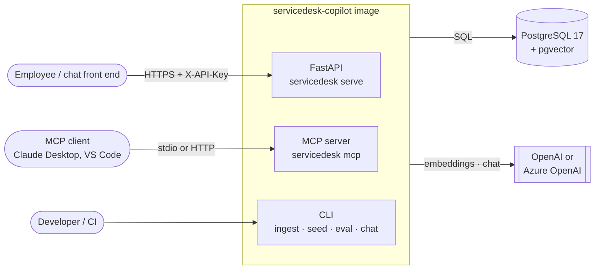
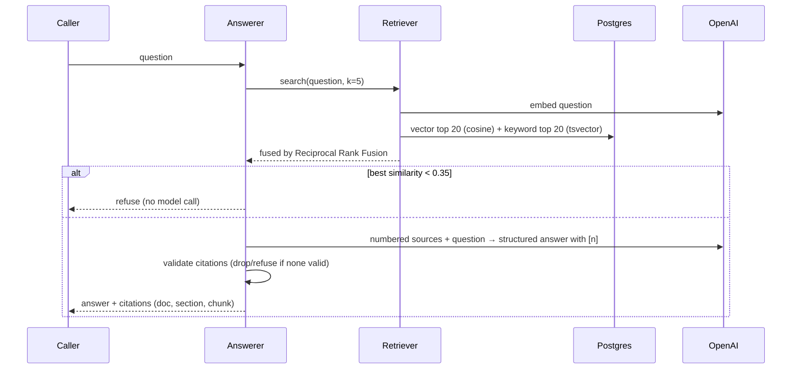
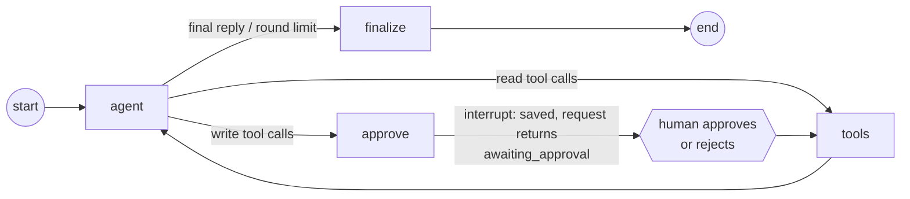
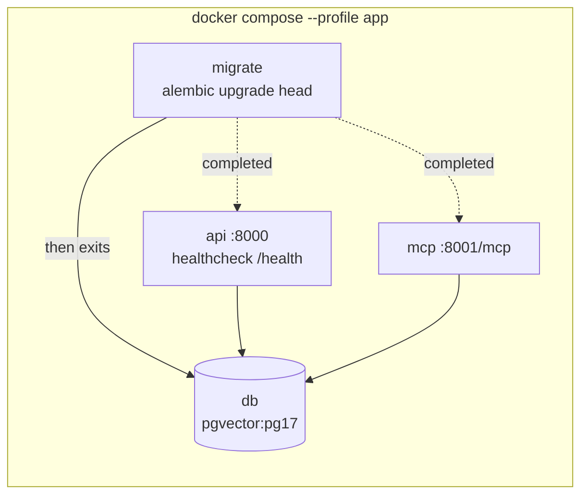

# Architecture

The Service Desk Copilot answers IT questions from a knowledge base with cited sources,
checks service status, and manages tickets, through four front doors that share one core:
an HTTP API, an MCP server, a CLI and an evaluation runner.

## System context



All three run from the same Docker image and the same Python package; they differ only in
the command. There is no separate worker or queue: every request is handled inside the
process that receives it.

## Layers

```
 front doors   api/ (FastAPI routes)   mcp_server/   cli.py   evals/
                    │                       │           │         │
 orchestration      └────── agent/ (LangGraph: model ⇄ tools, approval, checkpoints) ──┘
                                   │                      │
 capabilities      rag/ (answers + citations)      desk/ (tools: status, tickets)
                         │                                │
                   search/ (vector + keyword + RRF)       │
                         │                                │
 data              db/ (SQLAlchemy models, sessions) ── ingestion/ (load → chunk → embed)
                         │
                   PostgreSQL + pgvector              OpenAI (embeddings, chat)
```

Rules that keep it maintainable:

- **One definition per capability.** Each ticket/status tool is defined once in
  `desk/tools.py` (name, description, Pydantic input schema, handler, `writes` flag). The
  REST routes, the agent, the MCP server and the CLI are all built from that list, so a
  validation rule or a description fix reaches every caller (Phase 8's `search_tickets`
  fix did).
- **Business rules live in the service layer** (`desk/service.py`): status transitions,
  SLA targets, idempotency. Routes only translate errors to HTTP codes.
- **Dependencies are injected** (FastAPI `Depends`, constructor arguments), so tests swap
  in a test database, a fake embedder and a scripted chat model with no network.

## Data model

| Table | Holds | Notes |
|---|---|---|
| `documents` | one row per KB file | content hash for idempotent re-ingestion |
| `chunks` | ~500-token pieces with section/page | `embedding vector(1536)` (HNSW index), `search_vector tsvector` (GIN index) |
| `services` | IT service catalogue + health | operational / degraded / outage / maintenance |
| `tickets`, `ticket_comments` | the service desk | `INC-1001`-style numbers, SLA targets |
| `tool_executions` | idempotency keys of writes | a retried write returns the first result |
| `checkpoint*` | LangGraph conversation state | created by `langgraph-checkpoint-postgres` |

Schema changes go through Alembic migrations (`migrations/versions/`); the Docker stack runs
`alembic upgrade head` as a one-shot `migrate` service before the API starts.

## Key flows

### 1. Ingestion (offline, `servicedesk ingest`)
Markdown, HTML and PDF files → parsed with metadata → split into token-sized chunks along
headings → embedded in batches (with retries) → stored with a full-text vector. Unchanged
files are skipped by content hash; deleted files are pruned.

### 2. A knowledge-base answer (`POST /ask`)



### 3. A chat turn with an approval (`POST /chat`)



The graph state is checkpointed in Postgres after every step, so a conversation survives a
restart, a paused approval can be answered minutes later from another process, and a turn
that failed half-way (`/chat/{id}/resume`) continues from the last saved step. Writes run
with idempotency key `agent:<thread>:<tool_call_id>`, so a resumed turn never repeats one.

### 4. MCP
The same tools, exposed by the MCP SDK. Reads run directly; a write returns a preview and an
HMAC-signed `confirmation_token`, and only the identical call with the token writes (the
token's nonce becomes the idempotency key). The knowledge base is also published as MCP
resources (`kb://articles/{doc_id}`).

## Deployment view



See [deployment.md](deployment.md) for running it and for a cloud layout, and
[security.md](security.md) and [performance.md](performance.md) for those concerns.

## Technology choices

| Need | Choice | Why |
|---|---|---|
| API | FastAPI + Pydantic | typed request/response models, OpenAPI docs for free, dependency injection |
| Vector + relational data | PostgreSQL + pgvector | one database for tickets, chunks, vectors, full-text and checkpoints; transactions across them |
| Retrieval | hybrid (cosine + tsvector, RRF) | vectors for meaning, keywords for IDs and exact terms; RRF needs no score calibration |
| Agent | LangGraph | explicit graph, `interrupt()` for human approval, Postgres checkpointer for durable state |
| Tool protocol | MCP | lets any MCP client use the desk without custom integration |
| LLM | OpenAI (Azure OpenAI by config) | structured outputs; the provider is one setting |
| Packaging | uv + Docker multi-stage | locked, reproducible installs; small non-root runtime image |
